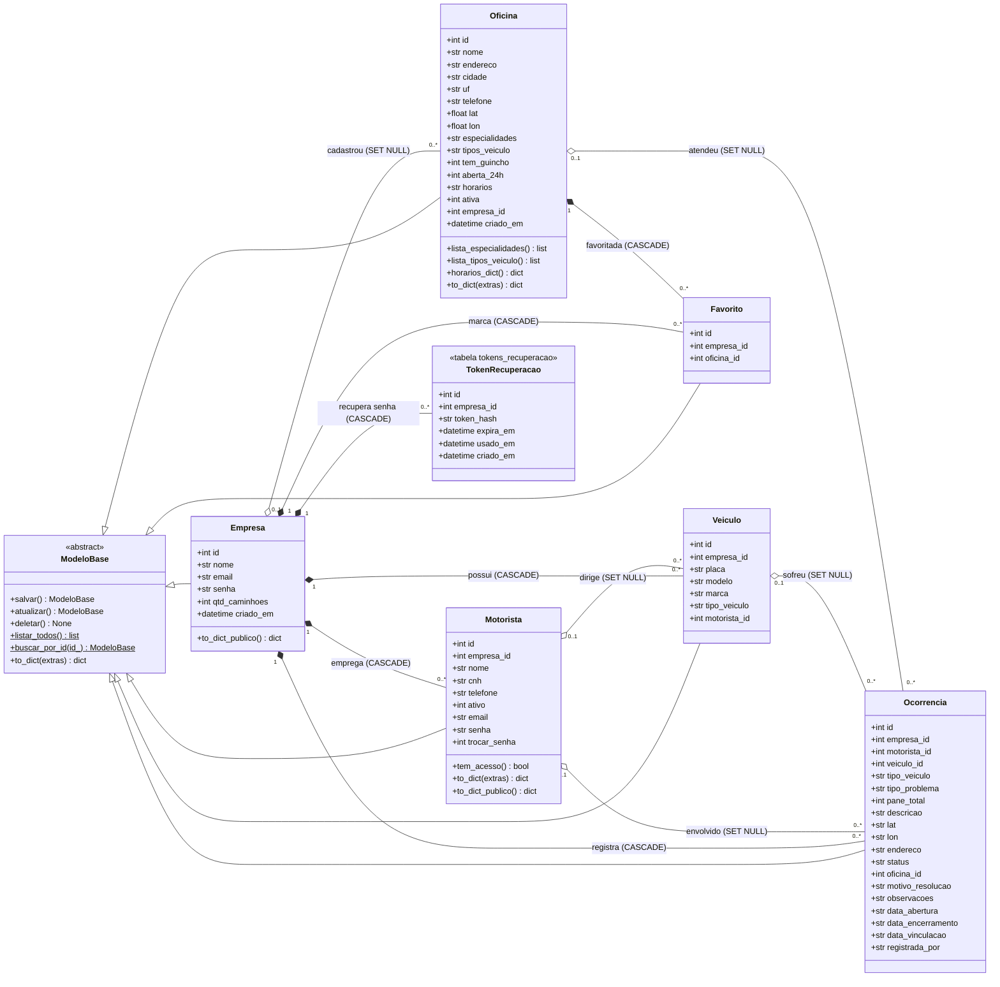
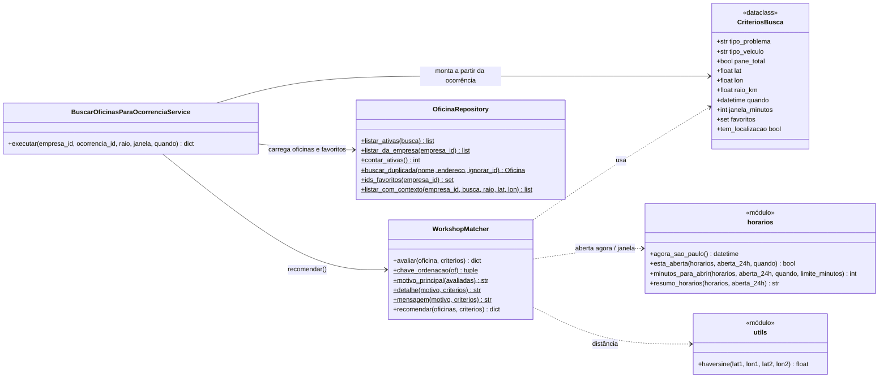
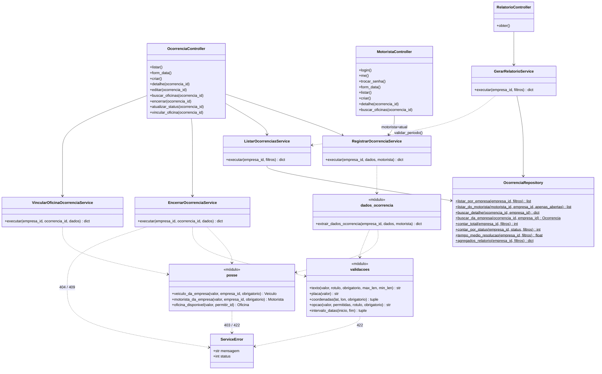

# Diagrama de classes — FixTruck

Gerado a partir do código em `backend/` (models, repositories, services e controllers).
Os diagramas usam Mermaid `classDiagram` e são renderizados direto no GitHub/GitLab
e no VS Code/Cursor com extensão de Mermaid.

Convenções: `+` público, `-` privado (prefixo `_` no Python), `$` estático
(`@staticmethod`/`@classmethod`). Tipos seguem as colunas do SQLite.

## 1. Modelo de domínio (models SQLAlchemy)

Cada model corresponde a uma tabela de `backend/database/create_database.sql`.
As multiplicidades e as regras de exclusão vêm das chaves estrangeiras do script.

Enumerações (CHECK no SQL e listas em `backend/constantes.py`):

| Campo | Valores |
|---|---|
| `Ocorrencia.tipo_problema` | mecânica, elétrica, hidráulica, borracharia, não identificado |
| `tipo_veiculo` (Veiculo, Ocorrencia) | leve, médio, pesado |
| `Ocorrencia.status` | aberta, em_atendimento, resolvido |
| `Ocorrencia.registrada_por` | empresa, motorista |

`TokenRecuperacao` não tem model SQLAlchemy: é acessado apenas por
`TokenRecuperacaoRepository` (SQL puro) e guarda só o hash SHA-256 do token.

## 2. Recomendação de oficinas (WorkshopMatcher)

Módulo puro, sem acesso a banco (`backend/services/workshop_matcher.py`).
Recebe dicionários de oficina (vindos de `OficinaRepository`) e os critérios da ocorrência.

Ordem dos critérios eliminatórios: inativa, problema, veículo, guincho (pane total),
horário e raio. Sem compatíveis, `recomendar` devolve `motivo`, `mensagem`, `detalhe`
e até 5 alternativas rotuladas como não compatíveis.

## 3. Camadas: fluxo de ocorrências

Padrão usado em todo o backend: Controller (Blueprint Flask) chama um Service por caso
de uso; o Service valida (`validacoes`, `posse`), lança `ServiceError(mensagem, status)`
e usa Models (CRUD SQLAlchemy) e Repositories (consultas em SQL puro).

Os demais controllers seguem o mesmo padrão: `AuthController`, `FrotaController`,
`OficinaController`, `PerfilController`, `DashboardController` e `OpcoesController`
(ver `backend/controllers/`), cada um com seus Services em `backend/services/`.
