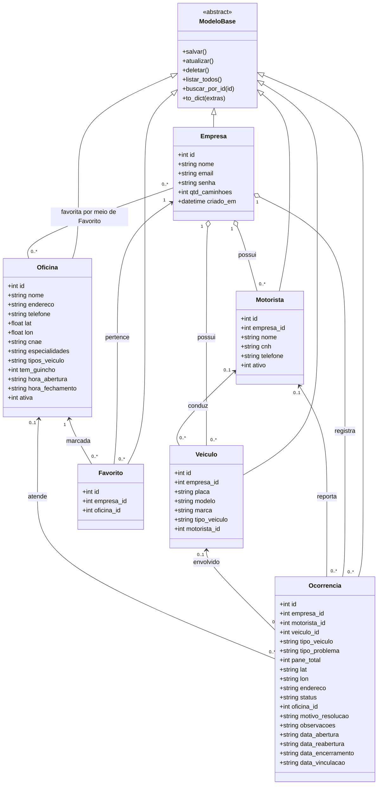

# Diagrama de classes do domínio FixTruck

O diagrama representa as entidades SQLAlchemy em `backend/models/` e seus vínculos por chaves estrangeiras. Os métodos CRUD comuns são herdados de `ModeloBase`.

## Relacionamentos e semântica

- **Herança:** todas as entidades concretas herdam de `ModeloBase`, que fornece as operações CRUD compartilhadas.
- **Agregação:** empresa e oficina são ligadas aos registros relacionados pelas chaves estrangeiras. A exclusão de registros referenciados é protegida pelas regras dos Services, não por exclusão em cascata.
- **Associação:** motorista, veículo, ocorrência e oficina se relacionam conforme as chaves estrangeiras opcionais mostradas no diagrama. `Favorito` é a classe associativa entre `Empresa` e `Oficina`, com unicidade para o par.
- **Composição:** não há composição forte implementada no esquema atual; a remoção de uma empresa, veículo, motorista ou oficina não apaga automaticamente registros dependentes.
